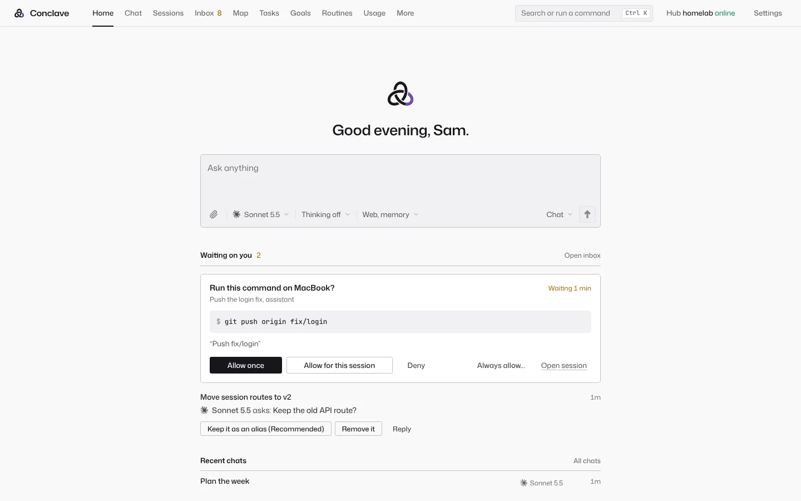

<div align="center">

# Conclave

**A self-hosted agent harness and hub: any model, your machines, one transcript.**

[](https://github.com/default-cybe/conclave/releases/latest)
[](LICENSE)
[](https://github.com/default-cybe/conclave/actions/workflows/ci.yml)
[](https://conclave.dymnitguys.com)

</div>

Conclave runs coding agents on your own computers with any model, checks their work before a turn ends, and lets you steer them from the web, desktop, terminal or phone.

It is a hub you run on a home server, a Proxmox box or your desktop. The hub holds the agent loop, chats, memory, routines and keys. Your PCs and Macs dial out to it, so agents work on their files and shells without open ports. There is no Conclave cloud: model calls go straight to the provider you pick.

<p align="center">
  <picture>
    <source media="(prefers-color-scheme: dark)" srcset="site/img/home-desktop-dark.webp">
    
  </picture>
</p>

## Why Conclave

- **Its own harness for every model.** Built from Claude Code's public design: Read, Write, Edit, Bash, Glob, Grep, WebFetch, WebSearch, Task and Skill tools, permission rules, hooks, skills, subagents, auto-compaction and prompt caching. GLM, GPT, Gemini or a local model get the same tools Claude gets.
- **A verify gate.** After a turn that edited files, the project's check runs on the session's own device before the turn may end. A failure sends the agent back with the last 40 lines, up to 3 times per user turn.
- **Several models in one chat.** Ask a second opinion on any message, run a jury (juror names can be hidden from the judge), a debate, or loop until a command such as `bun test` passes.
- **Vendor CLIs in the same transcript.** Claude Code, Codex, Gemini CLI and OpenCode run as engines over the Agent Client Protocol (ACP). A Codex turn can be followed by a GLM turn in the same chat, and their permission prompts become Conclave approvals.
- **Limits do not stop work.** A usage limit moves the session to your next plan or key for the same model, in your account order, then to the next model on your Usage fallback list. Long waits pause the session and resume it when the window resets.
- **Subscriptions, not only API keys.** Sign in to Claude, ChatGPT, Google, Grok, Kimi and Muse plans through [CLIProxyAPI](https://github.com/router-for-me/CLIProxyAPI), which the hub runs for you.
- **Agents that watch each other.** A write to a file that another live session wrote in the last 10 minutes gets a conflict warning (or an approval). A turn with no progress for 5 minutes raises a stuck alert with Stop and Keep waiting.
- **Workflows in code.** Scripts use Claude Code's workflow API and run in QuickJS compiled to WebAssembly, with no file system, process or network. A journal lets a run resume after a crash or an edit, replaying finished calls.

## What else you get

- **Devices that dial out.** PCs and Macs connect out over a WebSocket. No inbound ports. Pick a device per session.
- **Approve from your phone.** Risky steps wait for your OK. Tap Allow or Deny from the Android app or a push notification.
- **Any provider.** Claude, GPT, Gemini, GLM, DeepSeek, Kimi, Qwen, OpenRouter, Ollama, LM Studio or any OpenAI-compatible API.
- **Bring your people.** Family or friends get their own accounts, chats, memory, keys, devices and plans on your hub. You can set a monthly budget on yours.
- **One memory.** Every model and device shares what it learned about you and your projects, with a Basic Memory adapter.
- **Routines that run themselves.** Morning briefs, server checks, or a daily look for new listings on a site. Missed runs catch up after downtime.
- **Files back from agents.** The ShareFile tool turns a PDF, image, spreadsheet or zip a session made into a file card with a preview and a Download button.
- **Updates when idle.** The hub installs a new release by itself once nothing is running.
- **Every device.** Web app, desktop app (Windows, Mac, Linux), Android app, iPhone home screen app and a terminal app.
- **Self-hosted and in control.** Docker, Proxmox LXC or a plain Linux box. Permission rules, a dangerous-command guard, checkpoints you can undo, and an audit log.

See [all features](https://conclave.dymnitguys.com/details.html#features) on the website, or [docs/DESIGN.md](docs/DESIGN.md) for how each one works and where it can fail.

## How it compares

| | Conclave | Hermes Agent | Cline | OpenCode | Codex | Pi | Gemini CLI | OpenHands | goose |
| --- | --- | --- | --- | --- | --- | --- | --- | --- | --- |
| Models from many vendors | yes | yes | yes | yes | ? | yes | Google only | yes | yes |
| Subagents | yes | yes | yes | yes | yes | no | partial | yes | yes |
| Hooks | yes | yes | partial | ? | yes | yes | yes | yes | ? |
| Skills and MCP | yes | yes | yes | yes | yes | yes | yes | yes | partial |
| Built-in verify gate after edits | yes | no | partial | no | no | no | no | no | no |
| Second opinion, jury or debate across models | yes | no | no | no | partial | no | no | no | no |
| Failover across accounts and models on usage limits | yes | yes | no | no | no | no | partial | no | no |
| Drives Claude Code, Codex or Gemini CLI as engines | yes | no | partial | no | no | no | no | yes | yes |
| Agents on several machines from one place | yes | partial | partial | no | partial | no | partial | yes | yes |
| Phone app or approvals from the phone | yes | partial | partial | partial | yes | no | no | partial | partial |
| Memory across sessions | yes | yes | partial | no | no | no | partial | no | yes |
| Scheduled routines | yes | yes | yes | no | partial | no | no | yes | yes |
| Scripted workflows | yes | partial | no | no | no | partial | partial | no | yes |
| Several people with their own data | yes | partial | partial | no | no | no | no | partial | no |
| Inline diffs in VS Code or JetBrains | no | no | yes | partial | partial | no | partial | no | no |
| OS or container sandbox for commands | no | yes | partial | no | yes | no | yes | yes | ? |
| Hosted cloud option | no | no | yes | no | yes | no | no | yes | no |
| License | AGPL-3.0 | MIT | Apache-2.0 | MIT | Apache-2.0 | MIT | Apache-2.0 | per repo | Apache-2.0 |

Checked on 2026-10-24 against each project's GitHub README and official docs. "no" means we did not find it listed there; "?" means we could not tell. Corrections are welcome in an issue.

Where others are ahead: Cline shows every edit as a diff inside VS Code and JetBrains. Codex, Gemini CLI and OpenHands run commands in an OS or container sandbox; Conclave has permission rules, approvals and a dangerous-command guard, but no sandbox yet. Codex, Cline and OpenHands offer hosted cloud agents; Conclave is self-hosted only. Hermes Agent connects to Telegram, Signal and WhatsApp. OpenCode lists more than 75 providers.

## Quick start

Run the hub on a computer that stays on. Then install the app on each device and pair it with a code from the hub's Devices page.

**Docker Compose**

```sh
mkdir conclave && cd conclave
curl -fsSLO https://github.com/default-cybe/conclave/releases/latest/download/docker-compose.yml
docker compose up -d
docker compose exec hub conclave remote   # prints your login link
```

**Proxmox LXC** (on the Proxmox VE host, as root; add `--dry-run` to see every command first)

```sh
curl -fsSLO https://github.com/default-cybe/conclave/releases/latest/download/conclave-lxc.sh
sh conclave-lxc.sh
```

**Linux and macOS** (also gives you the terminal app and the device program)

```sh
curl -fsSL https://github.com/default-cybe/conclave/releases/latest/download/install.sh | sh
conclave serve
```

No server? The desktop app can run the hub itself: choose **Run the hub on this computer** on its first page.

Full setup, remote access (built-in tunnel, your Cloudflare domain, Tailscale or your own URL) and updates are in [docs/INSTALL.md](docs/INSTALL.md). The website has the same steps in its [download section](https://conclave.dymnitguys.com/#download).

## Apps

| Platform | File |
| --- | --- |
| Windows | [Conclave-windows-x64-setup.exe](https://github.com/default-cybe/conclave/releases/latest/download/Conclave-windows-x64-setup.exe) or [Conclave-windows-x64.msi](https://github.com/default-cybe/conclave/releases/latest/download/Conclave-windows-x64.msi) |
| Mac, Apple silicon | [Conclave-mac-apple-silicon.dmg](https://github.com/default-cybe/conclave/releases/latest/download/Conclave-mac-apple-silicon.dmg) |
| Mac, Intel | [Conclave-mac-intel.dmg](https://github.com/default-cybe/conclave/releases/latest/download/Conclave-mac-intel.dmg) |
| Linux | [Conclave-linux-x64.AppImage](https://github.com/default-cybe/conclave/releases/latest/download/Conclave-linux-x64.AppImage), [.deb](https://github.com/default-cybe/conclave/releases/latest/download/Conclave-linux-amd64.deb) or [.rpm](https://github.com/default-cybe/conclave/releases/latest/download/Conclave-linux-x86_64.rpm) |
| Android | [conclave-android.apk](https://github.com/default-cybe/conclave/releases/latest/download/conclave-android.apk) |
| iPhone | Open your hub in Safari, then Share, then Add to Home Screen. |

Every file has a `.sha256` next to it. The desktop apps are not signed yet: on a Mac, right click the app and choose Open the first time; on Windows, choose More info, then Run anyway. Hub archives and the standalone device program are on the [releases page](https://github.com/default-cybe/conclave/releases/latest).

## How it works

```
  Web app  ·  Android  ·  iPhone  ·  Desktop app  ·  Terminal
                     |  HTTPS + WebSocket
          Hub (conclave serve) on your server
   agent loop · tools · memory · routines · usage · model gateway
                     |  daemons connect out over a WebSocket (no open ports)
          Daemons on your PCs and Macs
   files · shells · browser · Claude Code / Codex / OpenCode
```

The agent loop runs on the hub. Tools reach files and shells through the machine you pick for a session: the hub's own disk or a paired computer. The hub is TypeScript on Bun with one SQLite file. The Android app is Kotlin and Jetpack Compose. The desktop app is Tauri.

## Docs

| Doc | What it covers |
| --- | --- |
| [docs/INSTALL.md](docs/INSTALL.md) | Install, remote access, subscriptions, devices, people, updates |
| [docs/DESIGN.md](docs/DESIGN.md) | Every feature, why it is built that way, and where it can fail |
| [docs/EXTENSIONS.md](docs/EXTENSIONS.md) | Skills, slash commands, hooks, plugins and MCP servers |
| [docs/design/ACCOUNTS.md](docs/design/ACCOUNTS.md) | Several people on one hub: accounts, keys, budgets, threat model |
| [docs/MEMORY.md](docs/MEMORY.md) | How memory works, past chats, Basic Memory |
| [docs/WORKFLOWS.md](docs/WORKFLOWS.md) | Running and writing workflows |
| [CHANGELOG.md](CHANGELOG.md) | What changed in each release |

## Contributing

Issues and pull requests are welcome. Read [CONTRIBUTING.md](CONTRIBUTING.md) first, and open an issue before a large change. Pull requests need the CLA in CONTRIBUTING.md; tick its box in the pull request template.

```sh
bun install
bun run typecheck
bun test
```

## Security

Report security issues privately to the author through GitHub ([default-cybe](https://github.com/default-cybe)), not in a public issue.

## License

Conclave is licensed under the [GNU Affero General Public License v3.0 only](LICENSE) (AGPL-3.0-only). A commercial license is available from the author on request. Third-party notices are in [THIRD_PARTY_NOTICES.md](THIRD_PARTY_NOTICES.md).
